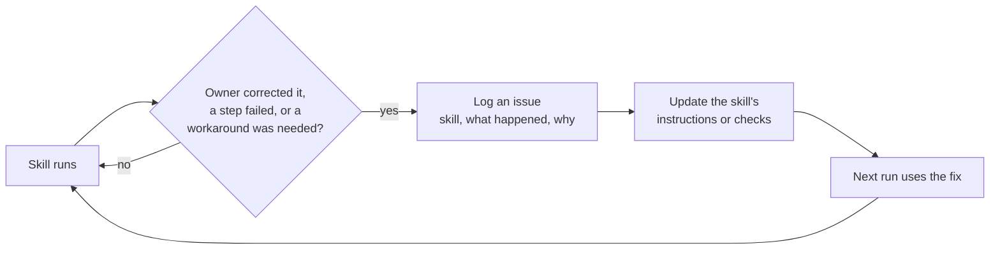

# Claude skills library and the improvement loop

I run most of my day-to-day automation through **Claude Code skills**: plain-English instruction
files that tell an AI agent how to do one job well (run the daily video pipeline, prepare a
loan-pipeline touch list, audit a data job, apply for a role). There are **80 skills across 9
project areas**, cataloged in a searchable database.

The part that matters is the loop that keeps them getting better.

## The tune loop

- Every correction becomes a **dated, written rule** in the skill, not a memory.
- Rules that can be checked by code become **checks that fail the run** (see the pre-publish
  check in [`../04-ai-pipeline-architecture`](../04-ai-pipeline-architecture)).
- Safety rules (human approval before anything sends, no sensitive data in prompts, no invented
  figures) are never removed by a tune.

## What's in this folder

| File | What it shows |
|---|---|
| [`example-skill/SKILL.md`](example-skill/SKILL.md) | A complete skill written for this repo, in the same format as my private ones: when to trigger, inputs, steps, guardrails, definition of done |
| [`issues_example.csv`](issues_example.csv) | The issue-log format the tune loop reads (illustrative rows) |

The private library stays private because many skills reference accounts, systems and customer
workflows. The format and the loop are the transferable part.
